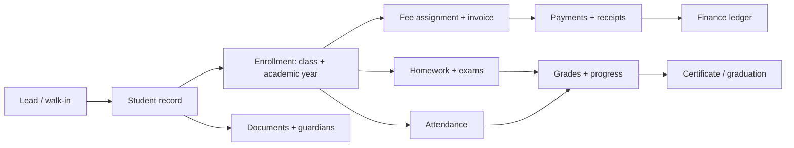
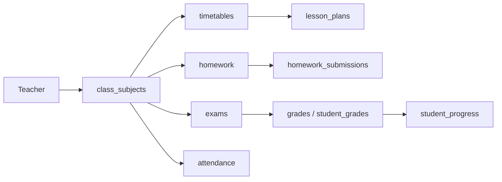
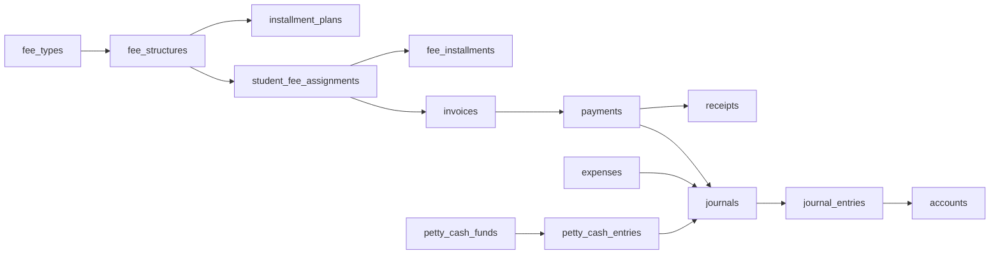
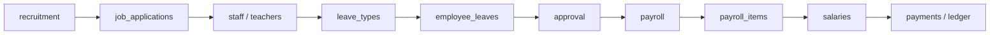
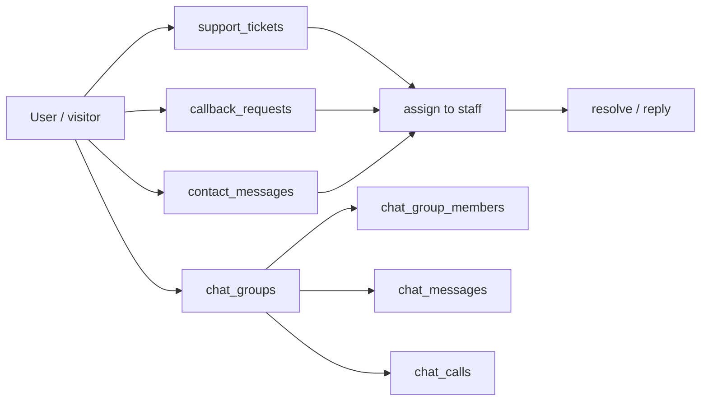
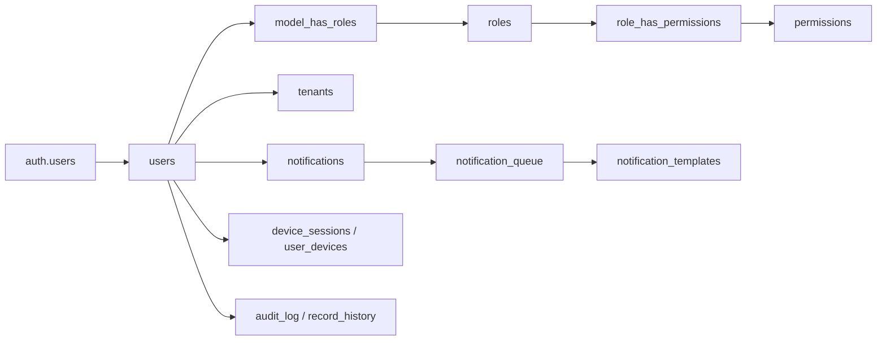
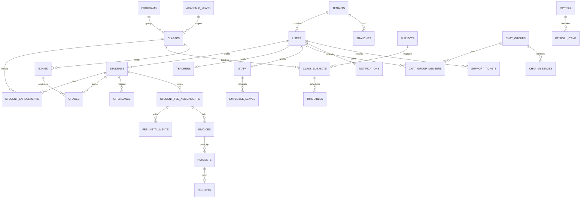

# EMIS / DreamFlow — System Design & Database Map

> Source of truth: `schema.txt` (Postgres export) + the current Next.js application code.
> Last analysed: 2026-10-29.

---

## 1. Snapshot

| Metric | Value |
| --- | --- |
| Tables defined in `schema.txt` | **100** |
| Additional tables used by code but missing from the export | **13** |
| Total tables modelled in the product | **113** |
| Tables actually referenced by application code | **33** |
| Tables defined but not wired to any screen/API | **80** |
| Application pages (`app/**/page.tsx`) | **33** |
| API route modules (`app/api/**/route.ts`) | **31** |
| Referenced-but-missing table (FK target) | `parents` |

### Stack

- **Frontend:** Next.js 16 App Router, React 19, TypeScript, Tailwind CSS.
- **Backend:** Supabase (Postgres, Auth, Storage, RLS) with Next.js route handlers under `app/api`.
- **Tenancy:** almost every domain table carries `tenant_id`; `tenants` is the root of the tree.
- **Identity:** `users` mirrors `auth.users`; effective permissions come from `model_has_roles` → `roles` → `role_has_permissions` → `permissions`, while `users.role` keeps a denormalised primary role.
- **Audit:** `audit_log`, `record_history`, `system_logs` and analytics `site_*` tables.

---

## 2. Module map

| # | Module | Tables | Used by app | Purpose |
| --- | --- | ---: | ---: | --- |
| 1 | Platform & tenancy | 9 | 1 | Platform settings, tenants, branches, audit |
| 2 | Identity & notifications | 7 | 1 | User profiles, devices, notifications |
| 3 | Academic structure | 14 | 3 | Years, programs, subjects, classes, timetable, rooms, courses |
| 4 | Student lifecycle | 9 | 3 | Students, enrollment, documents, progress, affairs, certificates |
| 5 | Teaching & assessment | 12 | 3 | Teachers, homework, lessons, exams, grades, attendance |
| 6 | Finance & accounting | 16 | 1 | Fees, invoices, payments, receipts, expenses, ledger |
| 7 | HR & payroll | 11 | 4 | Staff, leave, recruitment, payroll, salaries |
| 8 | Library | 4 | 0 | Books, issues, members, digital library |
| 9 | Support & communication | 13 | 4 | Tickets, feedback, announcements, events, chat, leads |
| 10 | Public site & facilities | 5 | 0 | Homepage CMS blocks, transport fleet |
| | **Total** | **100** | **20** | + 13 runtime tables = **33 used** |

---

## 3. End-to-end workflows

### 3.1 Student lifecycle (admissions → graduation)

Tables touched: `leads` → `students` → `student_enrollments` → `student_fee_assignments` / `invoices` → `payments` / `receipts` → `attendance` → `exams` / `grades` → `student_progress` → `certificates`.

### 3.2 Teaching & assessment

### 3.3 Finance & accounting

### 3.4 HR & payroll

### 3.5 Support & communication

### 3.6 Platform, identity & notification

---

## 4. Core entity relationship (simplified)

---

## 5. Table catalog

Legend: **✅ used** = referenced by current application code; **—** = defined but not wired yet.

### 5.1 Platform & tenancy (9)

| Table | What it stores | Status |
| --- | --- | --- |
| `platforms` | White-label platform name, logo, support contacts, global settings | — |
| `tenants` | Institute/branch organisation, plan, limits, branding, location | ✅ |
| `branches` | Physical branch locations, hours, manager | — |
| `addresses` | Polymorphic address book (profile, student, staff, tenant…) | — |
| `api_keys` | Tenant API credentials and scopes | — |
| `webhooks` | Outbound event subscriptions | — |
| `audit_log` | Generic action audit (action + table + record + old/new) | — |
| `record_history` | Row version history with soft-delete/restore support | — |
| `system_logs` | Runtime/application logs | — |

### 5.2 Identity & notifications (7)

| Table | What it stores | Status |
| --- | --- | --- |
| `users` | Profile mirror of `auth.users`, primary `role`, `tenant_id` | ✅ |
| `device_sessions` | Logged-in device sessions | — |
| `user_devices` | Push-notification device tokens | — |
| `notifications` | Per-user notification inbox with action URL | — |
| `notification_settings` | Per-user channel preferences | — |
| `notification_templates` | Reusable email/SMS/push templates | — |
| `notification_queue` | Delivery queue with retry/status | — |

### 5.3 Academic structure (14)

| Table | What it stores | Status |
| --- | --- | --- |
| `academic_years` | School year boundaries, current-year flag | — |
| `semesters` | Terms inside an academic year | — |
| `departments` | Departments and department head | ✅ |
| `programs` | Degree/diploma programs and credits | — |
| `subjects` | Subject catalog | — |
| `class_subjects` | Class ↔ subject ↔ teacher ↔ year mapping | — |
| `classes` | Class/section, grade, year, teacher, student count | ✅ |
| `timetables` | Weekly schedule slots (class, subject, teacher, room) | — |
| `rooms` | Classrooms, labs, halls with capacity | — |
| `holidays` | Non-working days | — |
| `courses` | Course catalog used by the app (code, credits, teacher, progress) | ✅ |
| `course_details` | Rich course metadata: fees, seats, syllabus, publishing | — |
| `course_resources` | Files, videos, links attached to a course | — |
| `admin_course_assignments` | Admin ↔ course access grants | — |

### 5.4 Student lifecycle (9)

| Table | What it stores | Status |
| --- | --- | --- |
| `students` | Student master record, guardian, fees, status | ✅ |
| `student_enrollments` | Enrollment per student + class + academic year | ✅ |
| `student_documents` | Uploaded/verified identity and academic documents | ✅ |
| `student_schedules` | Student weekly schedule | — |
| `student_progress` | Subject-level attendance, averages, trend | — |
| `student_groups` | Teacher-created study groups | — |
| `student_group_members` | Group membership | — |
| `student_affairs` | Counselor, academic standing, disciplinary records | — |
| `certificates` | Issued certificates with number/QR | — |

### 5.5 Teaching & assessment (12)

| Table | What it stores | Status |
| --- | --- | --- |
| `teachers` | Teacher master record, contract, salary, workload | ✅ |
| `teacher_qualifications` | Degrees and verified certificates | — |
| `homework` | Assignments per class/subject/teacher | — |
| `homework_submissions` | Student submissions, marks, feedback | — |
| `lesson_plans` | Teacher lesson plans with approval | — |
| `exams` | Exam scheduling, marks, weights | — |
| `exam_results` | Simple exam result rows (legacy/simple model) | — |
| `grades` | Grade rows tied to exam + class + student | ✅ |
| `student_grades` | Course-based grade rows | ✅ |
| `student_assignments` | Per-student assignment state/submission | — |
| `attendance` | Generic attendance for student/teacher/staff | — |
| `student_attendance` | Student attendance per class/course | — |

### 5.6 Finance & accounting (16)

| Table | What it stores | Status |
| --- | --- | --- |
| `fee_types` | Categories of fees (tuition, exam, transport…) | — |
| `fee_structures` | Amount rules per program/class/year | — |
| `student_fee_assignments` | Per-student fee obligations and balance | — |
| `fee_installments` | Per-installment payment state | — |
| `installment_plans` | Reusable installment templates per fee structure | — |
| `invoices` | Billing documents with totals and status | — |
| `payments` | Payment transactions | ✅ |
| `receipts` | Receipts issued against payments | — |
| `discounts` | Discount codes/rules and usage limits | — |
| `promotions` | Time-boxed campaigns and bundles | — |
| `expenses` | Operating expenses with approval | — |
| `accounts` | Chart of accounts | — |
| `journals` | Double-entry journal headers | — |
| `journal_entries` | Debit/credit lines | — |
| `petty_cash_funds` | Cash floats | — |
| `petty_cash_entries` | Petty-cash disbursements | — |

### 5.7 HR & payroll (11)

| Table | What it stores | Status |
| --- | --- | --- |
| `staff` | Non-teaching employee records | ✅ |
| `leave_types` | Leave categories and policy limits | — |
| `employee_leaves` | Staff leave requests and approvals | ✅ |
| `student_leaves` | Student leave requests and approvals | ✅ |
| `student_leave_tracking` | Monthly leave counters per student | — |
| `recruitment` | Job openings | ✅ |
| `job_applications` | Applicant pipeline and offers | — |
| `job_announcements` | Public job posts | — |
| `salaries` | Monthly salary rows per employee | — |
| `payroll` | Payroll runs/periods | — |
| `payroll_items` | Per-employee payroll lines | — |

### 5.8 Library (4)

| Table | What it stores | Status |
| --- | --- | --- |
| `library_books` | Book catalog and stock | — |
| `book_issues` | Issue/return records and fines | — |
| `library_members` | Library membership | — |
| `digital_library` | Digital assets (e-books, journals…) | — |

### 5.9 Support & communication (13)

| Table | What it stores | Status |
| --- | --- | --- |
| `support_tickets` | IT/support tickets with priority and status | ✅ |
| `feedback` | User feedback with rating and response | — |
| `announcements` | Institute announcements (multi-language) | — |
| `events` | School events | — |
| `event_registrations` | Event sign-ups | — |
| `chat_groups` | Direct/group chat threads | ✅ |
| `chat_group_members` | Chat membership and read state | ✅ |
| `chat_messages` | Chat messages, attachments, read-by | ✅ |
| `chat_calls` | Voice/video call log | — |
| `reception_events` | Front-desk events | — |
| `leads` | Admissions/marketing leads | — |
| `parent_students` | Parent ↔ student link (**FK to missing `parents`**) | — |
| `parent_messages` | Teacher ↔ parent messages | — |

### 5.10 Public site & facilities (5)

| Table | What it stores | Status |
| --- | --- | --- |
| `home_hero_sections` | Homepage hero slides | — |
| `home_features` | Homepage feature cards | — |
| `home_stats` | Homepage counters | — |
| `home_testimonials` | Homepage quotes | — |
| `vehicles` | Transport fleet and insurance | — |

---

## 6. Runtime tables used by code but missing from `schema.txt`

These 13 tables exist in the live database or were created by the app, but are **not** part of the export. Add them to `schema.txt` before treating it as authoritative.

| Table | Used by | Purpose |
| --- | --- | --- |
| `roles` | `/api/roles`, `/api/users`, `/api/abilities` | Role definitions (`name`, `slug`) |
| `permissions` | `/api/permissions`, `/api/roles` | Permission catalog |
| `model_has_roles` | `/api/users`, `/api/abilities`, `lib/analytics/auth` | User → role assignment |
| `role_has_permissions` | `/api/roles`, `/api/abilities` | Role → permission mapping |
| `branding` | `lib/branding.ts` | Site branding configuration |
| `site_sessions` | analytics collect/overview/realtime | Analytics sessions |
| `site_visitors` | analytics collect | Analytics visitor identity |
| `site_page_views` | analytics overview | Page-view events |
| `site_events` | analytics collect | Custom analytics events |
| `callback_requests` | support call-center/dashboard | Callback queue |
| `contact_messages` | support messages/dashboard | Public contact inbox |
| `social_media_links` | support social/dashboard | Social channel registry |
| `staff_attendance` | `/api/hr/attendance` | Staff attendance log |

Additionally, `parent_students.parent_id` references **`public.parents`**, which is not defined anywhere — a broken/missing parent table.

---

## 7. Application implementation map

| Screen | API route(s) | Tables read/written |
| --- | --- | --- |
| `/dashboard` | `/api/dashboard/stats` | `students`, `teachers`, `courses`, `payments`, `student_enrollments` |
| `/students` | `/api/students`, `/api/student-documents` | `students`, `student_documents` |
| `/courses` | `/api/courses` | `courses` |
| `/classes` | `/api/classes` | `classes` |
| `/grades` | `/api/grades` | `grades`, `student_grades`, `students` |
| `/payments` | `/api/payments` | `payments` |
| `/attendance` | `/api/hr/attendance` | `staff`, `staff_attendance` |
| `/leaves` | `/api/leaves` | `employee_leaves`, `student_leaves`, `staff`, `teachers`, `students`, `classes`, `departments`, `users` |
| `/staff` | `/api/staff` | `staff` |
| `/recruitment` | `/api/hr/recruitment` | `recruitment` |
| `/users` + permissions/roles | `/api/users`, `/api/roles`, `/api/permissions`, `/api/abilities` | `users`, `roles`, `permissions`, `model_has_roles`, `role_has_permissions`, `tenants` |
| `/support` | `/api/support/dashboard` | `support_tickets`, `callback_requests`, `contact_messages`, `social_media_links`, `users` |
| `/support/tickets` | `/api/support/tickets` | `support_tickets`, `users` |
| `/support/call-center` | `/api/support/call-center` | `callback_requests` |
| `/support/messages` | `/api/support/messages` | `contact_messages` |
| `/support/social` | `/api/support/social` | `social_media_links` |
| `/messaging` | `/api/messaging/*` | `chat_groups`, `chat_group_members`, `chat_messages`, `users` |
| `/observers` | `/api/analytics/*` | `site_sessions`, `site_visitors`, `site_page_views`, `site_events` |
| `/login` | direct Supabase | `users` |

**Pages with no table/API wiring detected** (static/demo content today): `/books`, `/feedback`, `/ports`, `/reports`, `/salaries`, `/settings`. There is also no `/exams` route yet even though exams tables exist. These need APIs before they can show real data.

---

## 8. How many tables do we need?

| Tier | Scope | Tables |
| --- | --- | ---: |
| **A — Implemented today** | Everything the current app reads/writes | **33** |
| **B — Core completion** | Academic years, subjects, fee engine, invoices/receipts, exams, notifications, parents, audit | **~20** |
| **C — Operations** | Payroll, ledger, library, events, recruitment pipeline, certificates | **~25** |
| **D — Optional / CMS / advanced** | Inventory, transport, CMS blocks, digital library, webhooks | **~35** |
| **Full platform** | A + B + C + D | **~113** |

Rules of thumb:

- A working **MVP of the school workflow** needs **≈33 + 20 = 53 tables**.
- If you start from scratch, design **20–25 core tables first** (`tenants`, `users`, `roles`, `permissions`, `students`, `teachers`, `staff`, `programs`, `classes`, `subjects`, `class_subjects`, `student_enrollments`, `attendance`, `exams`, `grades`, `fee_types`, `fee_structures`, `student_fee_assignments`, `invoices`, `payments`, `receipts`, `notifications`, `support_tickets`, `audit_log`), then add modules.
- The current database is **over-designed for the implemented UI** (80 unused tables) and **under-designed in access control** (`roles`/`permissions` are live but not in the export).

### Minimum core set (fresh design)

| Domain | Tables |
| --- | --- |
| Tenant & people | `tenants`, `users`, `roles`, `permissions`, `model_has_roles`, `role_has_permissions`, `students`, `teachers`, `staff`, `parents` |
| Academic | `academic_years`, `programs`, `subjects`, `classes`, `class_subjects`, `student_enrollments`, `timetables` |
| Assessment | `attendance`, `exams`, `grades` |
| Money | `fee_types`, `fee_structures`, `student_fee_assignments`, `invoices`, `payments`, `receipts`, `expenses` |
| Communication | `notifications`, `support_tickets`, `chat_groups`, `chat_group_members`, `chat_messages` |
| Governance | `audit_log` |

---

## 9. Schema issues & recommended cleanup

1. **Missing `parents` table** — `parent_students.parent_id` points to `public.parents`, which does not exist. Either create `parents` (linked to `users`) or repoint to `users(id)`.
2. **Duplicate academic models** — pick one model per concept:
   - `grades` vs `student_grades` vs `exam_results` (three grade stores, two are live).
   - `attendance` vs `student_attendance` vs `staff_attendance`.
   - `courses` vs `course_details` vs `programs`/`classes`.
   - `students.class_id`/`course_ids` vs `student_enrollments`.
3. **Status value casing is inconsistent** — e.g. `student_assignments.status` uses `'Pending'`, most other tables use lowercase. Normalise to lowercase enums or add CHECK-backed domains.
4. **Tenant coverage gaps** — `chat_groups`, `chat_messages`, `chat_calls`, `chat_group_members`, `parent_messages`, `student_*` tables and `library_books` lack `tenant_id`. This breaks strict multi-tenant isolation and scoping policies.
5. **Two role sources** — `users.role` (text) and `model_has_roles` can diverge. Treat `users.role` as a denormalised cache and enforce sync.
6. **`schema.txt` is incomplete** — 13 runtime tables and the role/permission stack are missing; analytics and support tables are absent. Re-export with `pg_dump --schema-only` and store it as the canonical file.
7. **80 unused tables** — decide per table: wire it into a screen, archive it, or drop it. Dead schema slows onboarding and migration risk.
8. **No `deleted_at` convention** — some tables use status/'cancelled', others use `is_active`. Standardise soft-delete.

---

## 10. Suggested next steps

1. Re-export the real schema and replace `schema.txt`; add `parents` + role tables.
2. Freeze the academic and grading model (choose `student_grades` + `attendance` as canonical).
3. Add `tenant_id` to chat and student sub-tables, then write RLS policies per tenant.
4. Build APIs for the pages that still show static data: books, exams, feedback, salaries, reports.
5. Only then implement Tier B tables (fee engine, invoices, notifications).
